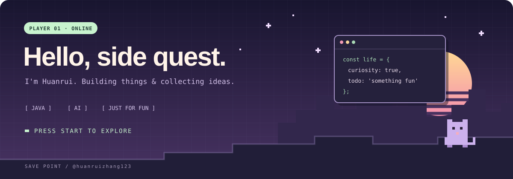

<p align="center">
  
</p>

<h1 align="center">这里是 Huanrui 的存档点 🕹️</h1>

<p align="center">
  偶尔写代码，经常开脑洞。<br />
  发现好玩的工具 → 研究一下 →「这个我好像也能做」。
</p>

<p align="center">
  <a href="#player">玩家资料</a> ·
  <a href="#quests">支线任务</a> ·
  <a href="#backpack">背包物品</a>
</p>

<h2 id="player">👾 玩家资料</h2>

```text
玩家 ID    huanruizhang123
出没地点   代码编辑器 / AI 对话框 / 新建文件夹
常用技能   Java、业务系统、把想法变成一个能打开的东西
隐藏技能   把「简单改一下」玩成大型支线任务
当前状态   正在加载下一件想折腾的事……
```

<h2 id="quests">🪐 最近解锁的支线</h2>

| 地图 | 探索内容 |
| :--- | :--- |
| 🤖 **AI 游乐场** | 试模型、玩 Agent，看看工具还能整出什么新花样 |
| 🛠️ **代码工坊** | 写点 Java，修点 Bug，再顺手挖个新坑 |
| 📦 **业务副本** | 在质量管理和仓储流程里寻找正确的任务路线 |
| 🎨 **视觉实验室** | 折腾网页、演示和文档，让「能用」再好看一点 |

<h2 id="backpack">🎒 背包里有什么</h2>

- 📖 **一本技能书**：[JavaGuide](https://github.com/Snailclimb/JavaGuide) · [我的 Fork](https://github.com/huanruizhang123/JavaGuide)
- 🧩 **一些新点子**：先记下来，万一哪天就做出来了。
- 🪛 **一套工具箱**：遇到重复的事，总想给它加个自动挡。
- 🕳️ **若干待填的坑**：文件夹已经建好了，进度就先不问了。

---

<p align="center">
  <b>任务提示：不必每一次折腾都有用，好玩也算经验值。</b><br /><br />
  <sub>存档成功。欢迎下次来串门 👋</sub>
</p>
